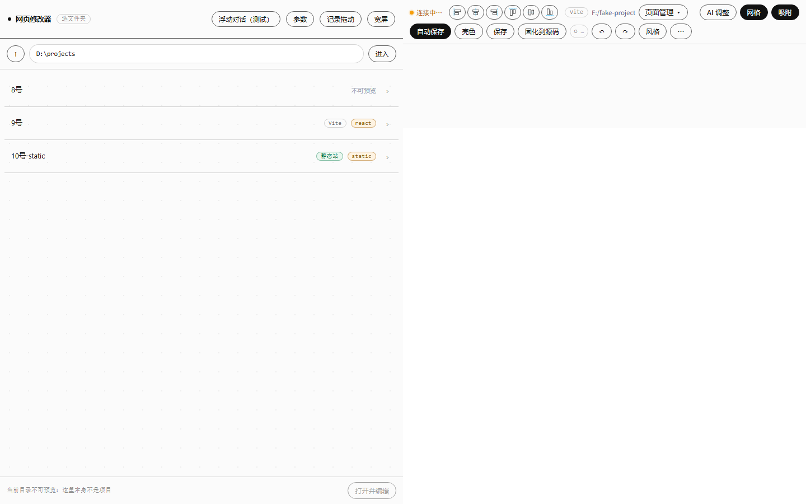
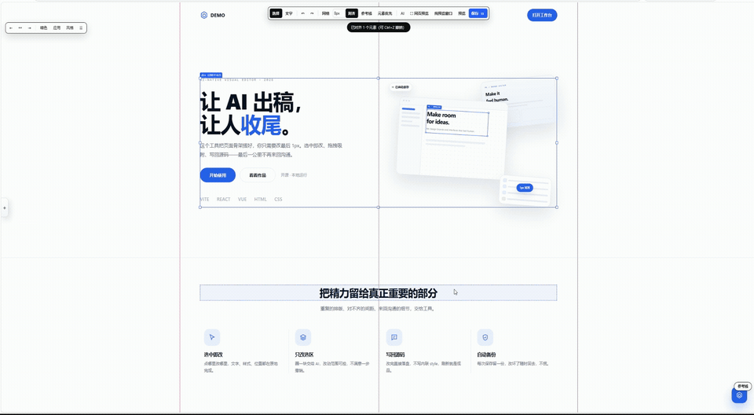

# DSH Visual Editor

Also known as Web Visual Editor (`visual-editor`).

Edit the page you already have — text, images, sizes, spacing, positions — right in the browser,
then write the result back into source files. Every save keeps a backup. No npm dependencies,
runs locally and offline.

[中文说明](README.md) · [DSH plugin docs](dsh-plugin/README.md) · MIT License





Two ways to use it:

1. **DSH plugin (recommended)** — pick a project folder, edit live in the right sidebar, select a
   region and hand just that region to AI.
2. **Standalone workbench / Vite plugin / static server** — open the same editor in its own window,
   or mount it into any Vite project or static site.

---

## What it does

| Need | How |
|---|---|
| Change copy | Double-click text to edit in place; line breaks preserved |
| Typography | Font size, weight (300–900), line height, letter spacing, color, alignment, family |
| Images | Replace an ``, insert a new image, paste inline SVG |
| Move elements | Drag; `Alt` disables snapping; arrow keys nudge 1px (`Shift` = 10px) |
| Grid & snapping | Grid 2–100px + snap to element edges / center lines |
| Resize | Drag handles; `Shift` keeps the aspect ratio |
| Undo / redo | `Ctrl+Z` / `Ctrl+Shift+Z`, 200 steps |
| Write back | Text → `content.json`; styles & geometry → `overrides.json` + `editor-overrides.css` |
| Backups | Every save copies changed files into `.ve-data/backups/<timestamp>/` |
| AI edits | Natural language → whitelisted operation JSON → preview → apply |

## Quick start

### 1) DSH plugin

```bash
node dsh-plugin/install.mjs
```

Restart DSH, open a project from the sidebar, and edit the page live.

### 2) Standalone workbench

```bash
node tools/visual-editor/server.mjs --root "path/to/project"
# open http://127.0.0.1:5270/
```

### 3) Try the demo in this repo

```bash
node tools/visual-editor/server.mjs --root demo
```

Open the URL, click **✎ Edit** in the bottom-right corner, or go straight to `?ve=1`.

> If the folder contains multiple HTML files, the root URL shows a **page picker** first; you can also pass `--entry page.html` or open `/page.html` directly.

### 4) Install into a Vite project

```bash
node tools/visual-editor/install.mjs "path/to/vite-project" --data-attrs
```

The installer copies the runtime, backs up `vite.config.ts`, patches the plugin array
(idempotent), and adds `.ve-data/` to `.gitignore`. `--data-attrs` injects
`data-ve-id="src/Component.tsx:line:col"` into every JSX element, so overrides are recorded
against real source positions instead of fragile CSS selectors.

## How saving works

Style edits are injected as a `<style>` sheet with `!important` (not inline styles), so they
survive framework re-renders. Text edits write to `content.json` when a unique match exists;
otherwise they go to the override layer.

| Change | Written to | In production |
|---|---|---|
| Text (unique match in `content.json`) | `content.json` | Works out of the box |
| Text (no / ambiguous match) | `.ve-data/overrides.json` | Needs the runtime or a manual copy |
| Typography / colors / radius / opacity | `overrides.json` → `editor-overrides.css` | `import "./editor-overrides.css"` once |
| Position / size | `overrides.json` (`transform` / `width` / `height`) | Same as above |
| Hidden elements | `overrides.json` (`display:none`) | Same as above |
| Images / SVG | `public/` + `attrs` in `overrides.json` | Needs the runtime or a manual copy |

Backups live in `.ve-data/backups/<timestamp>_<random>/` (last 40 kept). Restore:

```bash
curl -X POST http://127.0.0.1:5270/__ve/restore \
  -H "x-ve-token: <token>" -H "Content-Type: application/json" \
  -d '{"id":"20261030-123704_t4rb"}'
```

## AI edits

Configure any OpenAI-compatible endpoint in the panel (base URL / model / key). The model never
touches the DOM directly:

```
your instruction + selected element info + page outline
  → model returns whitelisted JSON ops
  → server validates (no javascript:, no expression(), no event attrs, no unknown CSS)
  → editor applies them as normal editable operations (undoable, previewable)
  → nothing is written until you press Save
```

Select an element first and scope the request to **“selection only”** to keep AI changes
predictable.

## Keyboard shortcuts

| Key | Action |
|---|---|
| Click | Select element |
| Double-click text | Edit in place (`Enter` save, `Esc` cancel) |
| Drag | Move element |
| `Alt` + drag | Temporarily disable snapping |
| Drag handle | Resize (`Shift` = proportional) |
| `Ctrl+Z` / `Ctrl+Shift+Z` | Undo / redo |
| `Ctrl+S` | Save |
| `Alt` + arrows | Nudge 1px (`Shift` = 10px) |
| `Delete` / `Backspace` | Hide element |
| `Esc` | Deselect / leave preview |
| `V` / `T` | Select / text mode |

## Repository layout

```
dsh-plugin/          DSH plugin: right-sidebar tab, routes, install & release scripts
workbench-ui/        Standalone workbench (project dashboard, editor, style library)
tools/visual-editor/ Editor kernel: runtime, core logic, HTTP API, Vite plugin, tests
demo/                Demo static site used by the docs and tests
deliverables/        Promotional assets (social cards, GIFs)
releases/            Packaged plugin tarball
```

## Tests

Five suites, 122 checks, all green on Windows + headless Edge:

| Suite | Command | Checks |
|---|---|---|
| Kernel / API unit | `node --test tools/visual-editor/test/core.test.mjs tools/visual-editor/test/api.test.mjs` | 27 |
| Host plugin | `node dsh-plugin/host-e2e.mjs` | 34 |
| Client renderer | `node dsh-plugin/client-e2e.mjs` | 37 |
| Undo branches | `node tools/visual-editor/e2e/undo.mjs` | 10 |
| Workbench UI | `node tools/visual-editor/e2e/workbench.mjs` | 14 |

Run everything:

```bash
node tools/visual-editor/e2e/run-all.mjs
```

## License

MIT — see [LICENSE](LICENSE).
