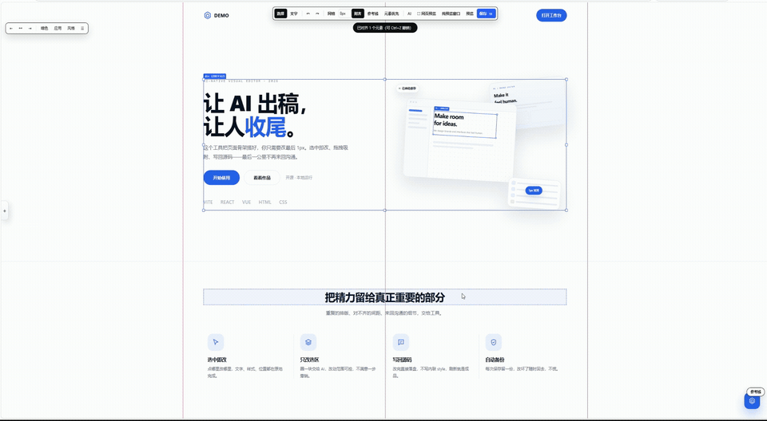

# DSH 网页可视化编辑器（visual-editor）

[English](README.en.md) · 中文

在**已经做好的网页上**直接改字、换图、调尺寸、拖位置，改完**回写源码文件**，每次保存前**自动备份**。
零依赖（不装任何 npm 包），本地离线运行。

> **两种用法**：
> ① **DSH 插件**（推荐，开箱即用）：选一个源码文件夹 → 右侧抽屉里实时编辑 + 框选交给 AI，见 [`dsh-plugin/README.md`](dsh-plugin/README.md)
> ② 独立工具（本文档）：装进任意 Vite 项目，或直接托管静态站



---

## 一、它能干什么

| 需求 | 状态 | 怎么用 |
|---|---|---|
| 改文字内容 | ✅ | 双击文字就地改，或右侧面板「内容」；保留换行（`<br>`） |
| 改字号 / 字重 | ✅ | 面板「文字」页：字号、字重 300–900、行高、字距、颜色、对齐、字体 |
| 改 / 替换图片 | ✅ | 选中 `` → 面板「图片」→「选一张图替换」（自动上传落盘） |
| 插入新图片 / SVG | ✅ | 面板「插入新图片」；或「粘贴 SVG 源码」 |
| 内联 SVG | ✅ | 可改尺寸、`fill`、整体替换源码 |
| Canvas（含 three.js） | ✅ | 拖手柄或面板改宽高，同步 CSS + 触发 `resize`，并调用页面注册的适配钩子 |
| 元素自由拖动 | ✅ | 直接拖；`Alt+拖` 临时关吸附；`Alt+方向键` 微调 1px，`Shift+Alt+方向键` 10px |
| 网格吸附 | ✅ | 工具栏选密度：2/4/8/10/12/16/20/24/32/48/64/100 px，随时切换 |
| 吸附到元素边缘 / 中线 | ✅ | 「对齐」按钮；开网格时网格优先，够不到网格再吸元素 |
| 撤销 / 重做 | ✅ | `Ctrl+Z` / `Ctrl+Shift+Z`，200 步 |
| 隐藏 / 重置元素 | ✅ | 面板「隐藏这个元素」「重置这个元素的改动」 |
| 回写源码 | ✅ | 改文字 → 回写 `content.json`；样式/几何 → `overrides.json` + `editor-overrides.css` |
| 每次保存留备份 | ✅ | 写盘前自动把被改文件复制到 `.ve-data/backups/<时间戳>/` |
| AI 改稿 | ✅ | 自然语言 → 模型输出**白名单操作 JSON** → 预览 → 确认后应用 |

---

## 二、两种用法

### A. 装进 Vite 项目（推荐；支持回写源码 + 精确到源文件行号）

```bash
node tools/visual-editor/install.mjs "D:\小红书\Portfolio （白点）"
```

安装器会：① 复制内核到 `<项目>/tools/visual-editor/` ② 把 `vite.config.ts` 备份到 `.ve-data/backups/<时间戳>_install/` ③ 在插件数组里加 `visualEditor({...})`（幂等，装过不重复）④ 把 `.ve-data/`、`editor-overrides.css` 写进 `.gitignore`。

加 `--data-attrs` 还会顺手把 `react()` 换成 `react({ babel: { plugins: [visualEditorBabel()] } })`，给每个 JSX 元素注入 `data-ve-id="src/组件.tsx:行:列"`：

```bash
node tools/visual-editor/install.mjs "D:\AI\网站测试集合\9号" --data-attrs
```

然后：

```bash
cd "D:\小红书\Portfolio （白点）"
npm run dev
```

浏览器打开后，**右下角点「✎ 编辑」**。插件还会给每个 JSX 元素注入 `data-ve-id="src/组件.tsx:行:列"`，所以覆写是按**源位置**记录的，比你手写 CSS 选择器稳得多（改版后只要那行还在就对得上）。

不想改 `vite.config` 的话，也可以手动加三行：

```ts
import { visualEditor, visualEditorBabel } from "./tools/visual-editor/vite-plugin.mjs";

export default defineConfig({
  plugins: [
    visualEditor({ contentJson: "src/content.json", publicDir: "public", cssOut: "src/editor-overrides.css" }),
    react({ babel: { plugins: [visualEditorBabel()] } }), // 可选：注入 data-ve-id
  ],
});
```

### B. 直接改任意静态站（不需要装进项目）

```bash
node tools/visual-editor/server.mjs --root "D:\某个静态站" --content src/content.json --public public --css-out src/editor-overrides.css
```

打开 `http://127.0.0.1:5270/`。适合已经构建好的 `dist`、纯 HTML 页面、或者你不想动它配置的站点。

> 目录里有多个 HTML 时，根路径会先显示**页面选择器**，选一个再进编辑器；也可以 `--entry 页面.html` 指定默认页，或直接访问 `/页面.html`。

### C. 先看效果（本仓库自带演示页）

双击 `启动演示.bat`，或：

```bash
node tools/visual-editor/server.mjs --root demo
```

打开 `http://127.0.0.1:5270/` 点右下角「✎ 编辑」，或直接开 `http://127.0.0.1:5270/?ve=1&sel=h1`。

---

## 三、保存后文件发生了什么

> **实现要点**：样式改动不是写内联 `style`，而是往页面里注入一张带 `!important` 的 `<style>` 表。
> 因为 React/Vue 重渲染会重写 `style` 属性（比如白点的 `style={{opacity}}`、9号 Hero 的滚动透明度），
> 内联改动会被冲掉；`!important` 样式表扛得住。这也是它能用在真实项目上的关键。

| 你改的东西 | 写去哪 | 生产环境怎么生效 |
|---|---|---|
| 文字（在 `content.json` 里唯一匹配） | **`src/content.json` 对应字段** | 自动生效（就是数据源） |
| 文字（匹配不到 / 不唯一 / 无 contentJson） | `.ve-data/overrides.json` 的 `text` | 需要运行时，或手动搬进源码 |
| 字号/颜色/字重/圆角/透明度… | `overrides.json` 的 `style` | 同步生成 `src/editor-overrides.css`，在 `main.tsx` 里 `import` 一次即可 |
| 拖动位移、宽高 | `overrides.json` 的 `box` | 同上（转成 `transform` / `width` / `height`） |
| 隐藏元素 | `overrides.json` 的 `hidden` | 同上（`display:none`） |
| 换图 / 插入图片 | 图片复制到 `public/`（或 `.ve-data/uploads/`），路径记进 `overrides.json` 的 `attrs` | 需要运行时，或把图片路径手工写进源码 |

**备份**：每次写盘前，被改动的文件（`content.json` / `overrides.json`）连同清单一起复制到
`.ve-data/backups/<时间戳>_<随机>/`，默认保留最近 40 份。恢复：

```bash
curl -X POST http://127.0.0.1:5270/__ve/restore -H "x-ve-token: <token>" -H "Content-Type: application/json" -d "{\"id\":\"20261030-123704_t4rb\"}"
```

---

## 四、AI 改稿

面板点「AI」→「AI 接口设置」，填 **baseURL / 模型 / apiKey**（任何 OpenAI 兼容接口，含本地 ollama、one-api）。
配置存在 `.ve-data/ai.json`，不进 Git。

它**不是**让模型直接操作 DOM，而是：

```
你的指令 + 选中元素信息 + 页面结构摘要
   → 模型返回 JSON：{ops:[{type:"style"|"text"|"attrs"|"box"|"hide", ...}]}
   → 服务端白名单校验（拦 javascript:、expression、事件属性、非法 CSS 属性）
   → 编辑器当成普通编辑操作应用（可撤销、可预览）
   → 你点「保存」才写盘
```

想让它「知道」某个元素，先在页面上选中它，再把范围选成「只改选中元素」。

---

## 五、three.js / canvas 适配

改 canvas 尺寸时编辑器会：

1. 同步 `style.width/height`
2. 若页面注册了钩子 → 交给页面自己适配渲染
3. 没钩子 → 按 DPR 同步 `width/height` 属性并派发 `resize` 事件

页面里注册钩子（推荐，three.js 场景必做）：

```js
window.__VE_HOOKS__ = {
  resizeCanvas(canvas, cssWidth, cssHeight) {
    if (canvas !== myThreeCanvas) return false;   // 返回 false 表示不管这个 canvas
    renderer.setSize(cssWidth, cssHeight, false); // 只改绘制缓冲区，样式由编辑器管
    camera.aspect = cssWidth / cssHeight;
    camera.updateProjectionMatrix();
    return true;                                  // 返回 true 表示已处理
  },
};
```

面板「尺寸」页会显示是否检测到钩子。

---

## 六、快捷键

| 键 | 作用 |
|---|---|
| 单击 | 选中元素 |
| 双击文字 | 就地编辑（`Enter` 保存，`Esc` 取消） |
| 拖动 | 移动元素 |
| `Alt` + 拖动 | 临时关闭吸附 |
| 拖手柄 | 改尺寸；`Shift` 等比 |
| `Ctrl+Z` / `Ctrl+Shift+Z` | 撤销 / 重做 |
| `Ctrl+S` | 保存 |
| `Alt+方向键` | 1px 微调（`Shift` 为 10px） |
| `Delete` / `Backspace` | 隐藏选中元素 |
| `Esc` | 取消选中 / 退出预览 |
| `V` `T` | 选择 / 文字模式（工具栏） |

---

## 七、目录结构

```
tools/visual-editor/
  core.mjs        纯逻辑：网格吸附、对齐参考线、选择器、覆写合并、撤销栈（可单测）
  runtime.js      浏览器端内核：Shadow DOM UI、选择/拖动/面板/上传/AI 面板
  api.mjs         Node 侧：覆写读写、备份、上传、content.json 回写、AI 调用与白名单
  handler.mjs     HTTP 路由（独立服务器与 Vite 插件共用）
  server.mjs      独立静态服务器（用法 B / C）
  vite-plugin.mjs Vite 插件（用法 A）+ JSX 行号注入
  vite-plugin.d.mts 插件类型声明（没有它 strict 项目的 tsc -b 会报 TS7016）
  install.mjs     一键装进 Vite 项目（带备份、幂等、可选 --data-attrs）
  test/           node:test 单测（27 个）
demo/             演示页 + 浏览器 e2e/诊断页（_e2e.html / _diag.html）
```

---

## 八、跑测试

```bash
cd tools/visual-editor
node --test test/core.test.mjs test/api.test.mjs
```

浏览器端 e2e（需要本机 Edge/Chrome）：

```bash
node tools/visual-editor/server.mjs --root demo --port 5270 --no-open
# 另开一个窗口
"C:\Program Files (x86)\Microsoft\Edge\Application\msedge.exe" --headless=new --disable-gpu \
  --virtual-time-budget=9000 --dump-dom "http://127.0.0.1:5270/_e2e.html"
```

`_e2e.html` 会跑 26 项断言：面板回填、字号/文字实时生效、撤销重做、拖动 + 8px/16px 吸附、
canvas 尺寸 + 钩子调用、隐藏、保存落盘、二次保存生成备份、零运行时错误。

### 实测记录

| 目标 | 类型 | 结果 |
|---|---|---|
| 本仓库 `demo/` | 静态页 | 26/26 断言通过 |
| `D:\AI\网站测试集合\9号`（Terova） | Vite 6 + React 18 + Tailwind 3，827 个 JSX 元素 | 18/18 通过：源位置定位到 `components/Hero.tsx:45:14`、字号/文字/拖动实时生效、保存落盘、**滚动后 React 重渲染覆写不丢**、零运行时错误 |
| 安装器对真实 `vite.config.ts` 的 patch | — | 幂等、带备份（已用配置副本验证） |
| 装完后 `tsc -b` / `vite build` | 9号 项目 | 类型检查 0 错误、生产构建成功（1873 模块，2.62s），产物已清理 |

---

## 九、已知限制（诚实说明）

1. **拖动用的是 `transform: translate`**，不改布局流。所以元素之间不会互相挤开——这是「微调位置」而不是「重新排版」。要真排版得改 flex/grid 属性（面板「布局」页可以改 `display`）。
2. **文字回写只做唯一匹配**。同名文案出现多次时会退回覆写层，不会猜你想改哪一个。
3. **React 组件内部的文字**（比如 `{props.title}`）改的是渲染结果，回写到 `content.json` 靠的是文案匹配；如果你想精确改到 JSX 源码里的字符串字面量，需要再加一层 AST 改写（没做）。
4. **不是所有元素都能改文字**：含 ``/`<span>` 等子元素的容器会被拒绝，需选中里面的文字节点——避免把结构改坏。
5. **`data-ve-id` 会让 dev 模式的 DOM 多一批属性**（仅 dev，体积可忽略）；生产构建不注入。
6. **生产环境需要一次性接线**：样式改动靠 `import "./editor-overrides.css"`，文字改动靠 `content.json` 已经生效；插入的图片/覆写文字属于运行时层，要上线得手工搬进源码。
7. AI 只输出白名单操作，不会执行脚本；但仍建议用便宜的模型 + 自己复核，别把 key 提交进仓库。
8. 样式靠 `!important` 样式表，所以如果页面自己写了内联 `style="...!important"`，会赢过编辑器（实战中极少见）；此时可用「布局」页改 `transform`/`width` 之外的手段绕开。
9. **无头浏览器截图/自动化环境里**：`IntersectionObserver`、CSS 过渡、`requestAnimationFrame` 可能不推进（例如 9号 的 Reveal 入场动画会停在 `opacity:0`），这是被测页面的动画在无头环境的表现，不是编辑器问题；人工在真实浏览器里看是正常的。
