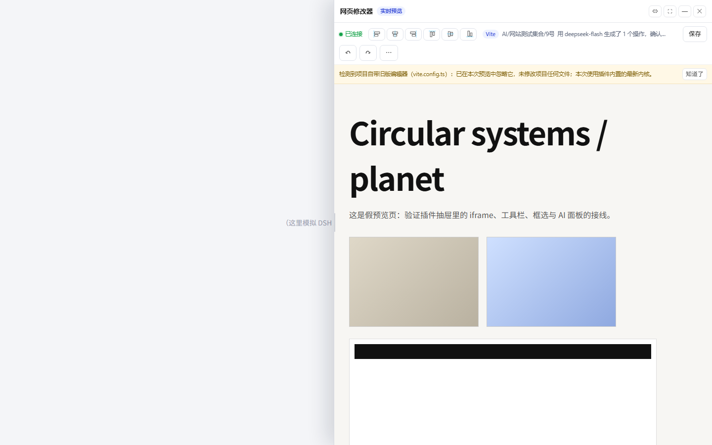

# DSH 网页可视化编辑器 · DSH 组合包（包名 `dsh-ui-editor`）

> **当前版本：1.1.13**（工作台 AI 调整弹窗 + 独立窗口直达当前项目；1.1.12 撤销分支修复 + 小胶囊描边减淡；1.1.11 修复 DSH 主题 squircle 导致圆角不圆；1.1.10 样式诊断自动上报；1.1.9 圆角自愈 + 版本弹窗诊断；1.1.8 胶囊圆角兜底 + 工具栏高度统一；1.1.7 页面菜单瘦身 / 对齐图标校准 / 快捷键归档；1.1.6 编辑器换工作台风格；1.1.5 目录可直接输入；1.1.4 修复「返回对话」；1.1.3 页面导航改成工具栏「☰ 页面」+ 下拉；1.1.1/1.1.2 胶囊常驻与只在编辑时显示；1.1.0 网页工作台 / 风格优化 / 固化 / 网格对齐；1.0.0 首个公开发布版）

在 DSH 里直接微调本地网页项目：点「网页修改器」→ 选源码文件夹 → 在**原生右栏 tab**里边看边改（文字/样式/图片/位移）→ 框选一片区域交给 **DSH 当前模型**改 → 保存回写源码（每次自动备份 + 历史可回滚）。

**v1.5.0 起使用新版 DSH 的公共右栏 tab API**（和「工作区文件 / 终端 / 浏览器」同一套 `sidebarRightTabs` + `sidebar.right.pane.tab` 插槽）：编辑器是一个真正的原生右栏 tab，随 DSH 布局一起伸缩/拖拽/展开，不再是浮窗；旧版 DSH 自动降级为悬浮抽屉。

也可以**由 Agent 直接打开**：对话里说「把 `D:\my-project` 打开做微调」，Agent 调工具后编辑器自动连上该项目。



> 截图说明：示意图，实际界面以当前版本为准。

---

## ⚠️ 安全提示（先读这段）

- 编辑器会**修改你选择的项目目录里的源码**：每次保存都会写回文件，并在项目下建 `.ve-data/` 目录存放覆写数据与**自动备份**（默认保留最近 40 份）。
- 所有改动都可以**撤销**（Ctrl+Z / 顶部 ↶）或**回滚**（⟲ 历史备份 / 「清空全部修改」）。
- 建议：**先在 git 仓库里使用**，或首次用前自行备份项目；不要直接对生产目录操作。
- AI 改稿走你在 DSH 里配置的模型，内容会按你的设置发送到对应服务商。

## 🧹 卸载与清理

1. DSH 里禁用/移除本插件（面板「插件」→ 移除 `dsh-ui-editor`），或删除 `~/.dsh/plugins/dsh-ui-editor` 与 `~/.dsh/profiles/node_modules/dsh-ui-editor`。
2. 项目里的痕迹：删除项目根目录下的 `.ve-data/`（内含 `overrides.json` 覆写、`backups/` 备份、`steps.json` 步骤、`shots/` 框选截图）。
3. 浏览器本地缓存（可选）：localStorage 里 `dsh-ui-editor:*` 与 `ve:*` 前缀的键。

## ⚡ 30 秒上手

1. 打开右侧「网页修改器」tab → 选一个前端项目文件夹（Vite / 静态站都行）。
2. **单击**页面元素选中它，**Ctrl+单击**打开属性面板。
3. 改文字/样式/尺寸 → 顶部 **保存**（或 Ctrl+S；自动保存开启时改动静置 2 秒也会保存）。
4. 改错了：**Ctrl+Z** 或顶部 ↶；想整体重来：菜单「⋯ → 清空全部修改」。
5. 更多操作都在「⋯」菜单里：自动保存、步骤历史、录制排障、图层、宽屏、深色外观、快捷键帮助。

## 📦 兼容性

- 需要带「原生右栏 tab」公共 API 的新版 DSH（与「工作区文件 / 终端 / 浏览器」同一套插槽）。旧版 DSH 会自动降级为悬浮抽屉模式。
- 预览使用本地 HTTP 服务（默认 127.0.0.1，端口被占用时自动顺延）。
- 仅本地使用：不上传你的源码；AI 改稿只发送你输入的需求与所选元素信息。

---

## 〇、它是什么

一个 **DSH 组合包（bundle）+ 宿主插件 + 客户端插件**：

```jsonc
"dsh": {
  "bundle": { "patch": "./cordis.patch.yml" },              // 组合包身份（面板「添加插件」的前提）
  "client": { "platform": "web", "immediately": true, "inject": [...] }  // 浏览器端插件
}
```

- **宿主插件**（`lib/index.js`，跑在 DSH 主进程）：起预览、代理 AI、注册 Agent 工具、暴露历史接口
- **编辑器内核**（`lib/vendor/`，注入到预览页面）：选择/拖动/网格/框选/应用操作/保存
- **客户端插件**（`lib/client.js`）：侧边栏按钮、右栏停靠、文件夹浏览、iframe、AI 面板、历史面板

---

## 一、功能

| 能力 | 说明 |
|---|---|
| 原生右栏 tab（1.5.0） | 编辑器 = DSH 原生右栏 tab（与「工作区文件 / 终端 / 浏览器」同级）：右栏指引页多一个「网页修改器」入口按钮；随右栏拖拽/收起/展开/全屏，不再遮挡对话；旧版 DSH 自动降级为悬浮抽屉 |
| 全屏编辑 | 标题栏「⛶」铺满窗口，只留底部一条悬浮窗（框选 / AI 改 / 保存） |
| 拖拽调宽 / 最小化 | 拖左边缘调宽；「⇔」窄/半屏/全屏；「—」收成右下角悬浮胶囊 |
| Agent 打开项目（1.1.0） | 模型可见工具 **`web_editor_open(dir)`**：Agent 调用后编辑器自动连上，结果含预览地址/项目类型/冲突信息 |
| 项目内旧插件冲突（1.1.0） | 项目自带旧版编辑器时，**只在本次预览的内存配置里过滤掉它**，项目文件一个字节不改；抽屉顶部提示 + 工具结果 `conflict` 字段交给 Agent 处理 |
| AI 免配置 | 默认用 **DSH 当前模型**（`ctx.llm` + `agentDefaultModel`，实测 deepseek-flash），无需任何 key；可切「自定义接口」填 OpenAI 兼容端点 |
| 元素编辑 | 文字 / 字号 / 字重 / 行高 / 字距 / 颜色 / 对齐 / 字体 / 图片替换 / 尺寸 / 位移 / 隐藏 |
| 元素信息 + 快捷操作 | 面板顶部显示 `标签#id.class · 宽×高 · (x,y) · 源组件` + 「👁隐藏 / ↑父级 / ✦闪烁 / ⌃上层 / ⌄下层 / 整段文字」 |
| 闪烁开关 | 开着时每次选中元素闪 7 下（约 3.5 秒），快捷键 `F` |
| 逐层选择 | 点到背景/覆盖层时，`Shift+点击` 或面板「⌃上层/⌄下层」在候选栈里换层；滚动后拾取缓存自动失效 |
| 链接保护 | 编辑模式点链接不跳转（提示目标地址）；`Alt+点击` 放行；面板「跳转」输入框直接改 href |
| 整段文字 | 被拆成逐词动画的文案：双击或点「整段文字」切成整段编辑（会合并成一段，逐词动画可能失效） |
| AI 设置默认收起（1.5.1） | 不再自动展开自定义接口表单；只有点「AI 设置」或切到「自定义接口」时才出现 |
| 选择框不再滞留（1.5.1） | 滚动/缩放后，选中元素变透明、隐藏或移出文档时自动取消选择；滚动时自动关掉闪烁框，不会在后续页面留下框 |
| 整段文字重写（1.5.1） | 自动上溯到真正的整句块容器，逐字/逐词动画层按字逐个回填（保留动画 span 结构），不再出现「开头文字消失」「只显示单词」；文本框显示完整整句（含空格） |
| SVG/小组件好选（1.5.2） | 媒体元素（svg/img/canvas/video）权重更高；点到 <a>/<div> 包装层时自动下钻到盖住点击点的小图标；≤160px 的小组件默认加分；点空白会提示「这里没有可编辑元素」 |
| 面板按类型自动切换（1.6.0） | 选中文字元素只显示「文字」页，图片/SVG 只显示「图片」页；尺寸/布局始终可用 |
| 文字草稿模式（1.6.0） | 面板底部常驻「保存 / 取消 / 重置这个元素」：改文字不实时写页面，可框选多个字一起改（回车=保存，Ctrl+回车=换行）；取消丢弃本次文字修改，重置恢复元素初始参数 |
| 文字样式控件（1.6.0） | 行高、字距改成数字 + 固定 px 后缀；字体、字重都是下拉菜单 |
| 删除与插入（1.6.0） | 快捷行新增「🗑 删除」（Del 快捷键）、「＋文字」「＋图片」「＋SVG」；插入的图形可选中后删除，页面元素删除=隐藏且可重置恢复 |
| 就地编辑可框选整段（1.7.0） | 双击段落进入就地编辑后，可以像普通文本一样框选、整段删除替换（之前一按鼠标就退出编辑）；Ctrl+回车换行、回车保存、Esc 取消 |
| 整段模式不再跳图片页（1.7.0） | 点「整段文字」后固定停在「文字」页；只有逐字/逐词碎片双击才自动升级为整段，正常段落双击=就地编辑 |
| 隐藏层不再抢选中（1.7.0） | 滚动动画里常见「两层重复 DOM，其中一层祖先 opacity:0」：现在按**自身+所有祖先**判断有效可见性，透明层不参与选择/不进入候选/排序重罚，不再选中页面上看不到的文案 |
| 插入元素可编辑（1.7.0） | 插入文字/图片/SVG 后自动选中并弹出「插入的元素」面板：X/Y、宽高、层级、换图、删除；插入输入框改成自绘弹层（Electron 不支持 window.prompt，之前点了没反应） |
| 容器整段文字（1.8.0） | 选中任何「含文字的元素」都能在面板里整段改文字（不再只有纯文本叶子）；改完点底部「保存」或回车应用 |
| 重置即时生效（1.8.0） | 重置用「首次改动前的 DOM 快照」还原 + 清空覆写层，点完立刻恢复原样，不再需要保存 |
| 插入元素分类面板（1.8.0） | 插入的文字显示文字编辑、SVG 显示源码编辑、图片显示换图；位置/尺寸/层级/删除通用 |
| 面板文字精准定位（1.9.0） | 选中容器时面板只编辑「主文字段」（逐字动画会升级成整句并提示）；不再把整块文字合并后乱分配，不会误改按钮文字；要整块合并点「整段文字」 |
| T 键文字模式（1.9.0） | 按住 **T**（或点快捷行「T 改文字」）再点击，直接抓取鼠标下那段文字，适合小字/图标旁的说明 |
| 重置文字可靠（1.9.0） | 所有会改 DOM 的路径（就地编辑、面板改字、换图、AI 应用）都在**改动前**抓快照，重置能真正恢复原始文字/图片 |
| 撤销作用域（1.9.0） | 输入框/文本框内 Ctrl+Z 走原生文本撤销、不动页面；面板底部新增 **↶ / ↷** 页面撤销/重做按钮（明确只撤页面改动）；上限 200 步内存栈 |
| 插入即编辑（1.9.0） | 插入文字后自动聚焦文字框可直接改；双击插入文字再编辑、双击插入图片换图、插入 SVG 自动聚焦源码 |
| 分割线填色 + 渐变（1.21.0） | 分割线的「线型」升级为 **填色：单色 / 渐变**。渐变复用文字的渐变编辑器：拉条、节点颜色+透明度、角度圆盘，可做两端渐隐或多色渐变；单色即实线。旧的「两端渐隐」数据自动升级成三节点渐变；颜色/渐变/方向/粗细都写回组件 HTML（data-ve-meta）与节点参数，保存刷新不丢 |
| 组件被下方黑幕覆盖（1.21.1） | 修正「退场太快」：去掉按滚动距离提前淡出，改为读下方升起黑幕（`.rise`）的上边缘，用 `clip-path` 把被盖住的部分裁掉——组件会和周围文字一起被那块黑色方块盖住，而不是提前淡出。开场/加载遮罩仍直接隐藏；所在图层淡出时跟着淡出。滚回去会恢复 |
| 组件不再出现在开场/切换（1.21.0） | 插入组件的可见度改为：邻近图层透明度 × (1 − 页面遮罩：开场 splash / 加载遮罩 / 滚动切换幕布) × (1 − 离插入位置的滚动距离 / 0.35 屏)。开场动画、翻段切换、离开插入的那一屏都会自动隐藏，回到原屏再出现；需要常驻的组件用「固定在屏幕」 |
| 旧草稿自动作废（1.21.2） | 页面里加 `<meta name="ve-build">` 构建号；编辑器的自动保存草稿会带上这个号，页面一更新（build 变）旧草稿自动清掉，不会再把上次没保存的旧样式恢复回来盖住新页面。顺手给交付页的 board.svg 请求加了版本号，避免浏览器缓存旧图 |
| 纯预览窗口（1.23.1） | 「纯预览」按钮改为**单独新开一个干净窗口**（URL 带 `ve_pure=1`）：没有任何编辑器界面、没有退出浮标，宿主侧边栏的小标志也不会出现；刷新后仍是纯预览，方便录开屏动画；脚本一加载就先藏编辑器，开场不会闪界面；组件层（分割线等）在纯预览里保留；窗口里 Esc 不会退出，关窗口即可离开。弹窗被浏览器拦截时退回当前窗口纯预览 |
| 纯预览模式（1.22.1） | 工具栏和组件坞都加了「纯预览」：进入后编辑器所有界面（组件坞、右侧面板、工具栏、收起把手）全部隐藏，同时不再绘制悬停/选中的蓝色框（之前刷新循环每帧重画，所以偶尔漏出蓝框），页面可以正常交互；浏览器允许时自动全屏，否则按 F11；右下角「✕ 退出纯预览」或 Esc 退出 |
| 新窗口 / 全屏预览（1.21.3） | 宿主侧边栏宽度有限、放不到全屏，编辑器里加了「⛶ 新窗口」按钮（工具栏和左侧组件坞底部都有）：点一下把当前页面在新窗口打开，编辑和实时预览都在新窗口里，按 F11 即真全屏；想只看画面先点「预览」隐藏编辑器 UI |
| 分割线实线 + 颜色即时生效（1.20.0） | 分割线默认改 **实线**（改颜色立刻整条线变色），面板新增「线型：实线 / 两端渐隐」；颜色控件同时监听 `input` 和 `change`（部分系统取色器只发 change），hex 输入合法即生效；方向/粗细/线型/颜色都写回组件数据，保存刷新不丢 |
| 面板自适应位置（1.20.0） | 编辑的元素在屏幕**右侧 1/3**（面板会挡住它）时，面板自动挪到**左上**（避开左侧组件坞）；元素在左侧 2/3 时保持默认**右上**；窗口缩放/滚动时自动更新 |
| 分割线设置不再丢（1.19.1） | 修「改颜色/粗细/方向没反应、保存后又变回默认」：保存时服务端只保留组件节点的白名单字段，会把预设/参数/颜色等丢掉；现在把这些设置编码进组件 HTML 的 `data-ve-meta`，刷新/保存后自动读回；服务端白名单也补上了这些字段。面板的横/竖方向还会按元素形状兜底，保证面板和画布上那条线一致 |
| 跟随周围组件（1.19.0） | 插入组件的默认定位改为 **「跟随周围」**：位置固定在你放的地方，但透明度跟着它所在的那一层（首页封面 → 标题/文案）一起淡出，滚动时的层级和动效与周围组件一致，不会每屏都出现、也不是机械地随页面滚动。「定位」三个选项：跟随周围 / 随页面滚动 / 固定在屏幕。面板标题和页签都显示具体类型（分割线 / 导航栏…） |
| 内核版本徽标（1.18.2） | 面板标题右侧显示当前内核版本（如 **v1.18.2**），点一下即刷新预览内核；选中分割线时标题显示「分割线」，历史分割线按 HTML 特征自动识别（即使数据里没存预设类型），不会再显示成「插入元素 / 元素」 |
| 插入组件定位（1.18.0） | 插入的组件默认 **「随页面滚动」**：只挂在插入的那一段页面上，滚到别的页面时它跟着页面一起走开（不会每一屏都出现）；组件面板「定位」可切 **随页面滚动 / 固定在屏幕**。插入时会记录页面坐标；已保存的组件再拖动/改参数也会正确进入「待保存层」并保存 |
| 右上面板布局调整（1.18.0） | 修掉面板的横向滚动条（按钮/输入框补 `box-sizing`），底部按钮一行排下、「重置元素」不再换行；面板宽度随窗口自适应；早期插入的分割线按 HTML 特征自动识别成「分割线」，直接套用专用面板 |
| 分割线独立面板（1.17.0） | 选中插入的分割线时，「组件」页变成专用精简面板：只显示**方向（横/竖）、长度、粗细、线条色、透明度、旋转、位置**，宽高/内边距/圆角/背景/文字色/层级自动隐藏；改粗细或颜色会实时重绘线条 |
| 渐变白字发灰修复（1.16.1） | 文字渐变会同时清掉该元素的 `text-shadow`：CSS 绘制顺序是「背景 → 文字阴影 → 文字」，阴影会盖在背景裁切出来的渐变字面上，把 100% 纯白压成约 85% 的灰（看起来「隐隐透灰」）。关掉后白就是实白。若确实想要发光，可用插入组件叠一层或后续加「发光」选项 |
| 拖组件不再全选（1.16.0） | 拖动插入的组件时不再触发浏览器「拖选整页文字」（不会整页变蓝、不留蓝色残影）；细长组件（竖分割线等）周围加 9px 透明热区，差几个像素也能抓住，不会误选中背后的整页 canvas |
| 组件残影修复（1.16.0） | 修复启动时插入组件被重复渲染成两个重叠 DOM 的问题（拖动其中一个、另一个留在原地＝「残影」）；现在同一组件只保留一份 |
| 旋转 / 分割线方向（1.15.0） | 「布局」页新增**旋转**（角度数字 + ↺/↻ 15° + 0° 归零）；插入的图片 / SVG / 分割线等组件在「组件」页也有旋转；并修复「变换」覆盖拖拽位移的问题（translate 与自定义 transform 现在叠加）。新建分割线可选**横线 / 竖线**，插入后「组件」页也能一键切换（宽高自动对调） |
| 蓝框不残留（1.15.0） | 插入组件的蓝色选中框在点选其它元素 / 取消选择后立刻清除；同时修复历史组件节点 tag 丢失或误存成 img 时的渲染异常 |
| 拖出删除节点（1.14.0） | 渐变拉条上的圆点**向上/下拖出拉条**（超过约 26px）就进入红色「✕ 松开删除」状态，松手即删；拖回拉条内取消；只剩两个节点时不允许删除 |
| 自动保存 + 草稿缓存（1.13.0） | 改动静置约 **2 秒自动保存**到项目（服务端照常备份轮转），面板顶部「⏱ 自动保存」可开关；每次改动同时实时写一份**草稿缓存**（按页面路径分开），刷新/崩溃/关标签后自动恢复未保存的改动；切后台或关页面时还会用 keepalive 补一次保存 |
| 渐变编辑器（1.12.0） | 颜色改为「单色 / 渐变」切换；渐变是一条**拉条**：两端圆点、点拉条中间可加节点、拖动圆点调位置；选中节点后改**颜色 + 透明度**，下方**角度圆盘**（或直接填数字）调方向。文字用背景裁切，内联 SVG 自动判断 fill / stroke 并注入 `<linearGradient>`，保存后重开预览仍然生效 |
| 双击改字更稳（1.11.0） | 双击落在画布/空白包装层（`pointer-events:none` 的封面、加载遮罩）时会按坐标兜底抓文字；双击同时打开面板，iframe 拿不到键盘焦点也能在「内容」框里改 |
| 内容框全选（1.10.0） | 文字面板「内容」旁新增**全选**按钮；文本框内 Ctrl+A 强制全选本框（不受宿主窗口全局快捷键影响） |
| T 模式抓文字更稳（1.10.0） | 按 T 后点击会按「文字图层」几何扫描抓取鼠标下那段文字，点击即进入文字编辑（不启动拖动），小字/说明文字也能抓到 |
| 快捷键作用域更严（1.10.0） | 用深度焦点检测（含 Shadow DOM）：焦点在任何输入框/文本域/可编辑区时，Ctrl+Z 只做文本撤销，绝不触发页面撤回；页面撤回请用面板底部 ↶/↷ 或非输入状态下 Ctrl+Z |
| 静态站入口识别（1.10.0） | 支持根目录是**跳转壳**的静态站（`meta refresh` / `location.replace`），自动跟随到真实入口（如 `/roadster/`）；根没有 index.html 时自动尝试 `dist / out / build / public / www` |
| 多项目独立 tab（1.9.0） | tab 类型允许多开：不同项目目录各开一个「网页修改器」tab（独立状态），同一目录 5 分钟内不重复开；Agent 打开新目录会自动新开 tab |
| 删除二次确认（1.8.0） | 删除页面元素先弹确认：隐藏（推荐）/ 仍然删除 / 取消；真正删除带 removed 标记，仍可「重置这个元素」或 Ctrl+Z 恢复 |
| 删除语义修正（1.7.0） | 删除=隐藏并**保持选中**（面板还在，可点 👁 显示 / 重置这个元素 / Ctrl+Z 恢复），不再出现「删了就找不回来」；Ctrl+Z 撤销上限 200 步（内存栈，刷新页面清空；已写盘的改动需要再保存一次才会回滚） |
| 四值布局（1.6.0） | 外边距 / 内边距 / 圆角拆成四个输入框 + 锁链按钮（圆角默认锁定，四角一起改） |
| 图标 / 任意元素换图（1.5.1） | 选中 SVG 图标会出现「颜色」控制（currentColor 生效）；任意元素都能「选一张图替换」（保持原占位大小），也能直接隐藏 |
| 历史回滚（1.1.0） | 预览工具条「⟲ 历史」列出每次保存的自动备份，一键恢复（恢复前当前状态也先备份），恢复后预览自动刷新 |
| 框选 → AI | 预览里拖一个框，把区域内元素（key/文字/位置/样式）交给 AI 生成白名单操作，确认后应用 |

---

## 二、安装

### 方式 A：DSH 面板导入（推荐）

1. 复制目录绝对路径：

   ```
   <本仓库目录>/dsh-plugin
   ```

2. DSH → **设置 → 插件 → 添加插件** → 填本地目录路径 → 安装
3. **完全退出 DSH 再打开**（托盘也要退出；只关窗口不算）

> 面板装好了包但侧边栏没按钮 = 没加进 `dsh.profile.bundles`，补一条（幂等）：
> ```bash
> node dsh-plugin/install.mjs
> ```

### 方式 B：命令行安装 / 更新 / 卸载

```bash
node dsh-plugin/install.mjs              # 安装 / 更新到最新构建
node dsh-plugin/install.mjs --uninstall  # 卸载
```

安装器会：刷新 `lib/vendor` 内核 → 复制到 `~/.dsh/plugins/dsh-ui-editor/` → **强制刷新** `~/.dsh/profiles/node_modules/dsh-ui-editor/` → 把包名追加进 profile 的 `dsh.profile.bundles`。

> ⚠️ 不要「面板导入 + 命令行安装」同时做（bundles 重复会让启动报错）；换方式先 `--uninstall`。
> 面板安装用 pnpm `link:`，所以改完插件代码 **重启 DSH 就生效**，不用重装。
> 但注意：`profiles/node_modules` 若残留旧副本会盖过 link（安装器会强制刷新它）。

---

## 三、用法

### 手动

1. 侧边栏底部「**✎ 网页**」→ 右侧原生右栏打开（对话区自动让位）
2. 目录浏览 / 粘贴路径 → 选源码文件夹 → **打开并编辑**
   - 「Vite」= 用项目自己的 Vite 起 dev server（不改任何配置文件）
   - 「静态站」= 进程内托管 `index.html` 并注入编辑器
3. 预览里点选元素 → 面板改文字/样式/位置
4. **▣ 框选** → 写指令 → **AI 改** → 看操作列表 → **应用到页面** → **保存**

### 让 Agent 打开

在对话里说：

> 打开 `D:\my-project` 做网页微调

Agent 会调用 `web_editor_open`，返回预览地址/模式/冲突信息；编辑器自动连上该项目（5 分钟内的新会话自动弹）。

---

## 四、它到底改了什么文件

| 你动的东西 | 落到哪 |
|---|---|
| 文字（在 `content.json` 里唯一匹配） | 项目 `src/content.json` 对应字段 |
| 样式 / 尺寸 / 位移 / 隐藏 | `.ve-data/overrides.json` + 同步生成 `src/editor-overrides.css` |
| 图片替换 | 图片进 `public/`，路径记进覆写层 |
| 每次保存前 | 被改文件备份到 `.ve-data/backups/<时间戳>/` |
| 每次保存 | 操作记录追加到 `.ve-data/history.jsonl`（撤回 / 后续 AI 学习用） |

**不会**动项目的 `vite.config.*`、源码 JSX/TSX。生产环境带上样式改动：在 `src/main.tsx` 里 `import './editor-overrides.css'` 一次即可。

---

## 五、架构

```
DSH 主进程                                        浏览器（DSH 窗口）
┌──────────────────────────────┐            ┌────────────────────────────────┐
│ 宿主插件 lib/index.js         │            │ 客户端插件 lib/client.js        │
│  · ctx.webServer /ve/plugin/* │◄──HTTP────►│  · 侧边栏「✎ 网页」按钮          │
│  · preview.mjs 预览管理       │  同源/19390 │  · 占 DSH 原生右栏（grid 第三列）│
│  · ctx.llm 原生 AI            │            │  · 文件夹浏览 / iframe / 历史     │
│  · ctx.tools 注册 Agent 工具  │            └───────────────┬────────────────┘
│  └ Vite 子进程 / 静态托管      │                            │ postMessage
└──────────────────────────────┘                            ▼
                                            ┌────────────────────────────────┐
                                            │ 预览页里的编辑器内核 runtime.js  │
                                            │ 选择/拖动/网格/框选/应用/保存    │
                                            └────────────────────────────────┘
```

- 桌面窗口是 `dsh-app://` 协议够不到 DSH HTTP 端口 → 宿主额外监听 **`127.0.0.1:19390`**（被占自动 +1），客户端自动探测
- 停靠方式：给 DSH 主框架（`display:grid` 三列）加 `data-wpe-dock` 并用 CSS 变量撑开第三列；关闭即移除
- 样式改动走注入的 `!important` 样式表，React 重渲染冲不掉
- AI 只在宿主侧调用，返回白名单操作 JSON；AI 不执行任何脚本

---

## 六、已验证 / 已知限制

**一键测试**：`运行全部测试.bat`（或 `node tools/visual-editor/e2e/run-all.mjs`），依次跑：

```bash
node --test                                       # core/api 单元 27：选择器 / 网格吸附 / 历史 / 样式生成 / AI 操作白名单 + 后端 store（保存/备份/恢复/上传/内容回写）
node dsh-plugin/host-e2e.mjs                     # 宿主 34：/ve/plugin 路由、打开/关闭预览、保存/历史/备份、风格库、handoff、agent 工具注册
node dsh-plugin/client-e2e.mjs                   # 渲染端 37：原生 tab / 抽屉 / 文件夹选择 / 工具栏 / 菜单文案 / 胶囊圆角(squircle) / 对齐按钮居中
node tools/visual-editor/e2e/undo.mjs        # 撤销分支 10：改→撤销→再改→连续撤销（真实内核 + 无头 Edge）
node tools/visual-editor/e2e/workbench.mjs   # 工作台 14：项目卡进编辑 / AI 调整弹窗 / 独立窗口直达当前项目
```

各套件测什么：

| 套件 | 覆盖 |
|---|---|
| core/api（`tools/visual-editor/test/*.test.mjs`） | 纯函数与后端行为：选择器互转、网格吸附/缩放、`createHistory`、`styleToCss`、AI ops 白名单；store 的保存/备份/恢复/上传/`content.json` 回写/风格库 |
| 宿主（`dsh-plugin/host-e2e.mjs`） | 插件宿主侧：`/ve/plugin/*` 路由、浏览目录、打开/关闭预览、保存/历史/备份、风格库、handoff、agent 工具、冲突检测 |
| 渲染端（`dsh-plugin/client-e2e.mjs`） | 真实 `client.js` 在 mock DSH 里：原生右栏 tab、抽屉兜底、文件夹选择、预览工具栏/菜单文案、胶囊圆角（模拟 DSH 全局 squircle 规则）、对齐按钮图标居中 |
| 撤销分支（`undo-e2e.mjs`） | 真实内核 `runtime.js`：改→撤销→再改→再改→连续撤销，验证分支截断、合并窗口、历史恢复不会退回旧分支 |
| 工作台（`workbench-e2e.mjs`） | 真实 `workbench-ui/app.js`：项目卡进编辑、AI 调整弹窗与 `agent.prompt`、独立窗口参数与直达编辑、布局一致 |

真机验收（每版都需要）：完全退出 DSH 重开 → 确认版本号 → 在真实项目里点一遍编辑/撤销/工作台独立窗口/AI 调整。

限制：

1. 停靠依赖 DSH 主框架 `grid` 三列结构（当前版本实测可用）；若 DSH 改版导致识别不到，会自动退回悬浮抽屉（不影响功能）
2. 项目类型：Vite（需已 `npm install`）或含 `index.html` 的静态目录；Next/Nuxt 暂不支持
3. 框选返回叶子元素（最多 30 个）的结构化信息，不是截图
4. 覆写层按 CSS 选择器寻址；项目结构大改后旧覆写可能对不上
5. 整段文字合并后，原逐词/逐字动画会失效（会有提示）
6. SVG 渐变依赖运行时注入的 `<linearGradient>`：只在生产环境 `import './editor-overrides.css'`、不带运行时的话，SVG 渐变不会生效（文字渐变正常）；Vite 项目在生产上使用 SVG 渐变需要额外引入运行时。

---

## 七、排错

| 现象 | 处理 |
|---|---|
| 添加插件报「declares no dsh.bundle」 | 旧包没有组合包声明；用当前 1.1.13 包 |
| 点「✎ 网页」没反应 | Console 执行 `window.__DSH_UI_EDITOR__.open()` 强制打开；把 `window.__DSH_UI_EDITOR__` 返回值发我 |
| 界面还是旧版 / 没有新按钮 | ①必须**完全退出 DSH**（托盘）再开；②确认 `~/.dsh/profiles/node_modules/dsh-ui-editor/lib/client.js` 里含新代码（install.mjs 会强制刷新）；③宿主版本 `/ve/plugin/ping` 应为 1.1.13 |
| 想确认是否工作在新版原生模式 | Console 里应有 `[dsh-ui-editor] 已注册原生右栏 tab（侧栏入口按钮已就绪）`；没有这行说明当前 DSH 没有右栏 tab API，已自动降级为悬浮抽屉（功能仍可用） |
| 原生模式下找不到入口 | ①左侧栏底部「✎ 网页」按钮（点击打开右栏 tab）；②右栏指引页（罗盘图标）里的「网页修改器」胶囊，和 工作区文件/终端/浏览器 并排 |
| 原生 tab 里显示偏窄 | tab 条右侧有 DSH 的展开/全屏控制；编辑器顶部「⛶」也会尝试调用右栏全屏 |
| AI 面板显示「DSH 模型（不可用）」 | 当前实例没暴露 llm 服务或读不到默认模型；切「自定义接口」填 key，或先在 DSH 设置里选好默认模型再重启 |
| 桌面窗口里列表报「连不上宿主」 | 桌面窗口走 `127.0.0.1:19390+`；Console 应打印「宿主接口已连接：http://127.0.0.1:19390」。若端口被占会自动 +1，日志里是实际端口 |
| 项目里装过旧版编辑器 | 预览时会自动忽略它（只在本预览内存里，不改项目文件），抽屉顶部有黄色提示条；Agent 工具结果里也有 `conflict` 字段 |
| 打开文件夹报「没认出项目类型」 | 项目没 `node_modules/vite`（先 `npm install`）或没有 `index.html` |
| 想彻底回滚 | `node dsh-plugin/install.mjs --uninstall` → 重启 DSH |

## 八、1.1.4 – 1.1.13：返回对话修复 + 目录可输入 + 编辑器换风格 + 菜单瘦身 + 圆角兜底 + 撤销分支修复 + 工作台 AI/独立窗口

- 工作台右上角「← 返回对话」现在走 DSH 官方布局接口 `layout.selectPanel(null)`（和左侧栏切换主面板同一条路径），点一下就是回到当前会话
- 不再乱试旧方法、也不再找「随便哪个带 对话/返回 字样的按钮」去点（那样可能点到「新建对话」）
- 失败时不会整页刷新，只在工作台页面里提示；「启动自动进工作台」的延迟重试会在你点「返回对话」后取消，不会被几秒后又拉回去
- 打开工作台也统一成 `layout.selectPanel("web-editor-workbench")`，和点左侧栏「网页工作台」一致
- Esc 关闭工作台走同一路径
- **「打开项目」的目录可以直接输入（1.1.5）**：顶部路径是输入框，输入 / 粘贴目录后按 Enter 进入；点「打开这个目录」会先跳到输入的目录再判断，路径无效会提示；支持带引号的复制路径
- **目录浮层去掉黑色外描边（1.1.6）**：只留纸面底色 + 轻阴影，内部分隔线保留
- **侧边「网页修改器」按工作台风格重排（1.1.6）**：单色纸面 / 细线 / 胶囊按钮；选中态一律黑底白字（不再用蓝色）；标题小黑点、等宽字体徽标与路径；文件夹列表细线分隔；菜单 / 弹窗 / 历史 / 风格选择 / AI 浮动条统一；文件夹选择页铺 34px 点阵底
- **页面菜单瘦身（1.1.7）**：工具栏「导航栏 ▾」更名**「页面管理 ▾」**；移除「显示悬浮导航胶囊 / 隐藏」和「🧹 清理旧版导航」两组按钮（胶囊默认常驻，旧导航在打开胶囊时自动清理）
- **⋯ 菜单精简（1.1.7）**：移除 复制元素 / 粘贴元素 / 复制样式 / 粘贴样式 / 固化到源码（真实页面生效）五个条目；复制粘贴快捷键见下方「快捷键」表，「固化到源码」仍有工具栏按钮
- **对齐按钮逐像素校准（1.1.7）**：六个对齐按钮统一 30×26，图标改用实测 SVG bbox 计算位移（原来顶部/垂直居中/底部三个偏 1~3px），现在图标内容中心 = 按钮外框中心
- **按钮圆角兜底（1.1.8）**：`ensureCss` 改成内容变化就替换（修掉「新界面 + 旧样式」混用导致圆角回到 7px）；胶囊圆角用 `!important` 钉死，宿主更高优先级规则也抢不走；主工具栏按钮高度统一 28px；`--wpe-*` 变量挂到 `:root` 一份
- **圆角不圆的真正原因与修复（1.1.11）**：DSH 主题插件给所有元素全局设置了 `corner-shape: superellipse(1.5)`（squircle 超椭圆圆角），会把 `border-radius:999px` 画成「圆角矩形」——computed 明明是 999px、看着却不圆。DSH 自己的按钮都会写 `corner-shape: round` 退出，插件里也统一补上（预览面板 / 抽屉 / 原生 tab / 弹窗 / 菜单 / 浮动 pill / 侧边入口按钮），测试里用模拟的全局 squircle 规则做回归
- **小胶囊描边减淡（1.1.12）**：步骤 N/N、静态预览、静态站等徽标胶囊 + 固化状态 chip 的描边改为浅灰（16% 黑），文字减淡；语义色（已固化绿 / 待固化琥珀）保留
- **撤销分支修复（1.1.12）**：撤销后的改动不再并进旧步骤，且会截断被撤销掉的旧分支——之前「撤销 → 新改 → 再撤销」会偶发退回到已经撤销过的旧变化。撤销/重做/步骤跳转后重置合并窗口；恢复历史时指针优先匹配持久化位置、再从该位置向两边找最近状态
  - 回归测试：`node tools/visual-editor/e2e/undo.mjs`（真实内核 + 无头 Edge，覆盖「改→撤销→再改→再改→连续撤销」分支场景）
- **工作台 AI 调整 + 独立窗口（1.1.13）**：编辑工具栏新增**「✦ AI 调整」**弹窗——写需求后自动带上项目路径/当前页面/框选元素，经宿主 `agent.prompt` 发给对话里的 Agent（独立窗口里走 REST `/ve/plugin/handoff`）；弹窗里可「▣ 框选元素」，框完自动回弹窗。**「↗ 独立窗口」**现在带当前项目目录/页面参数，启动后直接进该项目编辑视图，不再中转工作台首页；由宿主带 `api` 参数打开时隐藏独立模式连接条，布局与右侧栏内嵌工作台一致
  - 回归测试：`node tools/visual-editor/e2e/workbench.mjs`（真实 app.js + 无头 Edge，14 项）

## 九、1.1.1 / 1.1.2 / 1.1.3：页面导航（编辑器浮层胶囊 + 工作台工具栏页面菜单）

- **编辑器**：进入编辑态自动在页面顶部居中显示浮层胶囊（和左侧栏同一层 UI、`position:fixed` 不随滚动），默认折叠成圆形 ▶，点开显示全部页面链接、当前页高亮，点链接直接切页；默认常驻（1.1.7 起移除了页面面板里的显示/隐藏按钮，折叠/展开直接点胶囊本身）
- **网页工作台（1.1.3）**：不再用浮层胶囊，改成**顶部编辑工具栏里的「☰ 页面」按钮**（细线描边、和工作台现有按钮同一套视觉；展开时反色为黑底白图标），点一下在按钮**下方**展开页面下拉：当前页高亮、点哪页切哪页
  - 只在点进项目、正在编辑某页时出现；**工作台首页（项目仪表盘）不显示，点「← 工作台」退出编辑就消失**
  - 下拉里点空白处 / 再点按钮 / Esc 收起；切页时下拉自动关闭
  - 工作台编辑页里把预览内核的胶囊关掉（`ve_nav=0`），避免和工作台的页面按钮重影；被网页编辑器预览工作台自身时也不渲染，交给编辑器
- 编辑器打开胶囊时会自动摘掉早期写进页面源码/覆盖层的旧版导航胶囊（只影响当前预览，不改项目源码）
- 单页站点展开后显示「这个站点只有一页」；独立启动器 / 新窗口模式没有宿主页面列表时不显示空胶囊
- 独立启动器补了 `/ve/plugin/pages` 接口，工作台在纯本地模式也能读页面列表

## 十、1.1.0 新增：网页工作台 / 风格优化 / 固化 / 网格对齐

### 网页工作台
- **安装后启动 DSH 会自动进入网页工作台**（每个页面会话一次；右侧编辑器 ⋯ 菜单里可关闭「启动时自动进入工作台」）
- 左侧栏点「网页工作台」图标也可手动打开（占用主区域，Esc 或「← 返回对话」退出）
- 「打开项目」现在是**文件夹浏览器**：↑ 上一级 / 点文件夹进入 / 识别到前端项目后一键「打开这个目录」，不用手输路径
- 首页：大标题 + 打开项目 + 三条原则 + 最近项目缩略图（实时 iframe 预览）+ 风格优化栏目
- 顶部「⟳ 刷新」：重载工作台（固化或更新前端后用它）
- 工作台前端在 `workbench-ui/`（独立静态项目），可被编辑器自己编辑；改完 `node dsh-plugin/install.mjs` 同步

### 风格优化
- 工作台「＋ 添加风格」：填规范目录即可（识别 design-tokens.json、tokens.json、theme.json、*.css、UI-SPEC.md、README.md、fonts.css、cover.png 等）
- 卡片：竖版 3:4，中文 35px / 英文 22px，字体取自该风格规范，单色或磨砂底，右下角次色网点；规范里含「轮廓回声 / stroke token」时标题带轮廓底图
- 点击卡片 → 确认目标项目 → 生成 `.ve-data/style-brief.md` 并把短提示发给 Agent（Agent 会 read 该文件后按 token 改页面）
- 右侧编辑器「风格」按钮：同样可选风格并发送；⋯ 菜单里也有同一组

### 固化到源码（让真实页面也生效）
- 编辑并保存后，点工具栏「固化」（或 ⋯ 菜单）：
  - 纯静态站：生成 `ve-applied.js`（内嵌覆写数据）+ 在入口 HTML 注入 script
  - Vite：写 `src/ve-applied.js` 并在入口 JS 加 import
- 固化前自动备份到 `.ve-data/backups/fixate-<时间>/`；工具按钮旁的状态胶囊显示 已固化 / 待固化 / 未固化
- 固化脚本在编辑器预览（?ve=1）中自动跳过，不会和编辑器抢样式
- 已知限制：脚本在页面加载后应用；若页面之后又整体重渲染，可能被覆盖

### 网格对齐
- 右侧编辑器 ⋯ → 网格对齐：网格开关、精度 2/4/5/8/10/12/16/20/24/32px、吸附物体边缘开关；拖动与缩放立即生效

### 新增 Agent 工具
| 工具 | 作用 |
| --- | --- |
| `web_editor_styles` | 列出已保存风格（颜色/字体/简述） |
| `web_editor_apply_style` | 取风格规范、写 `.ve-data/style-brief.md`、返回短提示 |
| `web_editor_show_styles` | 在界面弹出风格选择面板 |
| `web_editor_add_style` | 从一个目录一键提取并保存风格（毫秒级） |

### 页面识别与切换（1.1.0 新增）
- 工具栏目录后面新增「页面：xxx ▾」：随时看到当前编辑的是哪一页，不会只对着一个长路径猜
- **静态站**：自动扫描项目内 `.html`（最多 3 层，跳过 node_modules 等），下拉即可切换；每项带页面 `<title>`
- **Vite / SPA**：识别为入口页，可在下拉里手动输入路径切换（如 `/about`）
- **新建页面**（仅静态站）：页面下拉输入文件名（支持中文，如 `关于.html`、`博客/文章.html`）→ 选模板：
  - `空白页`（默认）：保留站点 `<head>` 样式/脚本，正文换成占位内容
  - `复制当前页`：复制当前页结构后改标题
  - 可勾选「加返回首页链接」：新页面自动带一个 `← 返回首页` 链接（子目录页面自动算 `../` 路径）
- **撤销历史按页面保存**：每页的步骤历史持久化到 .ve-data/steps.json（其它页面在 .ve-data/pages/<页>/steps.json），切换页面或刷新后按原指针恢复，Ctrl+Z / Ctrl+Y 可以接着回退重做（之前每次打开都会重置成基线）
- **普通选择的层级规则**：`elementsFromPoint` 图层栈 + 评分排序（自身文字 +100 / 媒体 +70 / 文字容器 +30 / 小组件 +22；大面积无文字覆盖层扣分；透明/隐藏扣分；刚选过的元素有粘滞加分）；同一点再点一次按层级往下循环，Shift+点击选父级容器，Ctrl+Shift+点击多选
- **文字行盒优先（穿透覆盖层选字）**：点击位置落在文字行盒内时，把承载文字的元素排到第一候选——即使上面盖着背景视频/装饰层；点字间空隙也能命中该行文字；点远离文字的区域仍按图层选覆盖层
- **AI 输出的 JSON 解析更稳**：模型带解释文字 / 代码围栏 / 尾逗号 / 输出数组或按类型分组时都能解析；解析失败会自动重试一次（要求只输出严格 JSON）
- **回到编辑器保持上次项目+页面**：每次打开项目/切换页面都会记录 lastActive（项目+页面），重启后按它恢复，不再换案例/换页：每个项目记住最后停留的页面，重新进来按记忆恢复（不再随机换页）
- **文字优先选择**：点击位置落在文字行盒上时（即使上面盖着装饰层/覆盖层），直接选中承载文字的元素；再点一次同一位置可按层级循环到覆盖层，Shift+点击仍选父级
- **页面缩略图**：展开页面管理面板时自动用本机 Edge/Chrome headless 给每个页面截图（480×320，干净页面无编辑器 UI），列表里直接看各页缩略图；缓存到 `.ve-data/shots/pages/`，HTML 更新后自动重截，也可点「⟳ 刷新缩略图」手动刷新。仅静态站支持（Vite/SPA 会提示不支持）
- **删除前引用提示**：删除页面前会扫描其它 HTML 里指向它的 `href/src`，有引用会提示「有 N 处链接指向该页」，避免删完出现 404
- 删除/重命名/复制页面时，**缩略图缓存与页面数据目录会同步移动/清理**（中文页面旧目录会自动迁移到可读名字）
- 自定义 AI 接口（OpenAI 兼容）失败也会自动重试一次（和原生模型一致）
- **页面管理**（下拉每行右侧图标）：`✎` 重命名、`⧉` 复制、`🗑` 删除；删除/重命名前自动备份到 `.ve-data/backups/pages-manage-<时间>/`，入口页不可删除
- **AI 协作新建**：新建页面（或点「AI 调整」）后自动把「AI 新建页面」提示词填进 AI 条，内含规范：① 沿用首页 UI 规范 ② 先一次问完 3-5 个问题确认用途/板块/内容再实现 ③ 页面之间用「页面链接」组件互连 ④ 完成后提醒保存/固化
- Agent 工具新增 `web_editor_pages`：list / create / delete / rename / copy / switch，Agent 可直接创建、删除、复制、切换页面，并按上面的规范继续实现内容
- 工具栏「AI 速改」更名为「AI 调整」（同时负责改现有页面和新建页面）
- **删除恢复**：页面面板里「🗂 删除恢复」列出删除/改名/复制前的备份，可一键把 HTML 与页面数据恢复回来
- **工作台页面列表**：工作台项目卡片 hover「页面」→ 弹窗看各页缩略图，点页直接进编辑器打开该页
- **悬浮导航胶囊**（1.1.1 起默认常驻，1.1.2 起只在编辑网页时出现）：固定在页面顶部居中（和侧边栏同一层 UI、不随内容滚动），默认折叠成一个圆形 ▶；点开显示全部页面链接、当前页高亮，点链接直接切页
  - 编辑器：进入编辑态自动出现，默认常驻（和侧边栏同一层 UI）；1.1.7 起移除了页面菜单里的「显示 / 隐藏」按钮，胶囊折叠/展开直接在它自己身上操作
  - 网页工作台：只在编辑页顶部居中显示（当前项目的页面）；**首页项目仪表盘不显示，退出编辑即消失**。工作台编辑页里预览内核的胶囊会自动关闭，避免两个
  - 它是**编辑器 UI 元素**（和左侧栏/弹出面板同一层，存在 shadow DOM 里），不是页面插入元素：**不可编辑、不会重复、不用保存**
  - 打开时会自动摘掉早期写进页面源码/覆盖层的旧版导航胶囊（只影响当前预览，不改项目源码），避免出现两个
- **页面链接组件**：编辑器左侧「添加内容 → 页面链接」，选目标页面（或自定义 URL）+ 链接文字，插入一个可拖动的链接按钮，用于页面之间互相跳转

- **按页隔离**：每个页面的覆写/历史/步骤/备份独立保存（入口页沿用 `.ve-data/overrides.json`，其它页面存 `.ve-data/pages/<页面>/`），切页后互不干扰
- 固化会把**所有页面**的修改一起打包进 `ve-applied.js`，脚本按当前 URL 自动选用对应页面的数据；静态站固定时会给项目里所有 `.html` 注入引用
- Vite/SPA 的 `cssOut` 是合并所有页面的 CSS（同一文件），选择器以最后保存为准

### 编辑器其他改进

- **复制粘贴**：`Ctrl+C` / `Ctrl+V` 复制元素副本（自动偏移 14px，可拖动、可保存、可撤销）；`Ctrl+Shift+C` / `Ctrl+Shift+V` 复制一个元素的外观并粘贴到其它元素（支持多选批量）
- 多选：Ctrl+点击加入/移出，选中组可整组拖动；对齐可撤销
- 拖动/缩放内置 inline 兜底；行内元素自动提升为 inline-block
- 工具栏「AI 条」按钮 + Ctrl+Enter 兜底唤起 AI 改稿条
- 行内确认弹窗（应用风格 / 固化）替代原生 confirm

## 十一、快捷键（编辑器）

| 键 | 作用 |
|---|---|
| 单击元素 | 选中元素（命中优先，不弹面板） |
| Ctrl / ⌘ + 单击 | 选中并打开属性面板 |
| Shift + 单击 | 选父级容器（可连按往外走） |
| Ctrl + Shift + 单击 | 多选 / 移出多选（用于对齐） |
| 双击文字 | 就地编辑文字 |
| 双击容器 | 进入组（组内单击选内部元素） |
| 拖动 | 移动元素（默认按网格吸附；`Alt` 拖动临时关闭吸附） |
| `Alt` + 方向键 | 微移 1px（`Shift + Alt` 为 10px） |
| `Ctrl + C` / `Ctrl + V` | 复制元素 / 粘贴副本（偏移 14px，可拖动、可保存、可撤销） |
| `Ctrl + Shift + C` / `Ctrl + Shift + V` | 复制样式 / 粘贴样式（多选时批量应用） |
| `Ctrl + Z` | 撤销（焦点在聊天框里也能用） |
| `Ctrl + Shift + Z` / `Ctrl + Y` | 重做 |
| `Ctrl + S` | 保存 |
| `Ctrl + Enter` | 显示 / 隐藏 AI 改稿条 |
| `Del` / `Backspace` | 删除（隐藏）选中元素 |
| `Esc` | 取消选择 / 退出组 / 关闭弹层 |
| `B` | 收起 / 展开左侧组件栏 |
| 小键盘 `+` / `−` | 文字调字号；其它元素调宽高 |
| `Ctrl + ← / →` | 文字字距 |
| `Ctrl + ↑ / ↓` | 文字行距 |

> 页面管理、复制粘贴样式这些操作也可以从「页面管理 ▾」和「⋯」菜单里完成；1.1.7 起 ⋯ 菜单只保留常用的自动保存 / 清空修改 / 调试 / 视图条目，复制粘贴类快捷键以本表为准。

## 十二、独立启动器（不依赖 DSH）

**最简单**：把项目文件夹拖到根目录的 `启动独立编辑器.bat` 上（或双击后输入路径）。

命令行：

```bat
node tools\standalone\launcher.mjs --dir "F:\你的项目" --port 19391 --open
```

- 编辑器：`http://127.0.0.1:19391/?ve=1`（页面右下角点「✎ 编辑」）
- 工作台：`http://127.0.0.1:19391/ve/wb/index.html?api=...&standalone=1`
- 自动识别项目类型：Vite 项目会自动拉起项目自带的 dev server 并反代（含 HMR），静态站直接注入内核
- 能力：编辑/保存/覆写/历史/固化、风格库读取与应用（应用时把风格提示打印到终端，交给外部 Agent）
- Vite/React 项目：先自行 `npm run dev`；构建级写回见后续版本
- 详细说明见 `tools/standalone/README.md`

